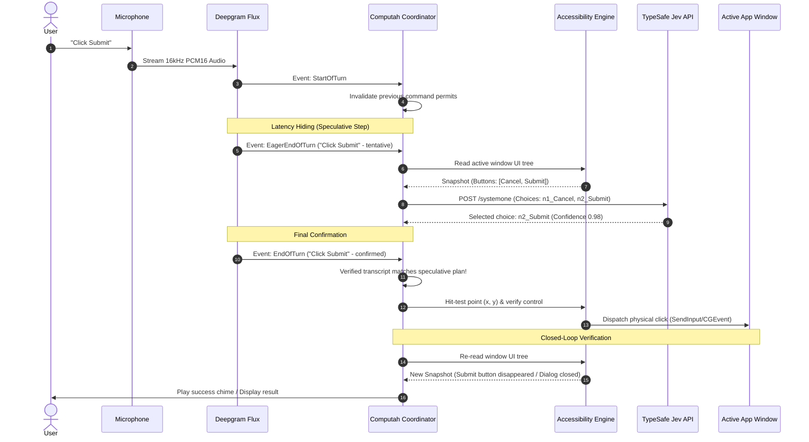

# Computah Reference & Windows Porting Architecture

> **Upstream Repository Reference:** [musubipapi/computah](https://github.com/musubipapi/computah)  
> **Core Concept:** Hands-free, voice-driven operating system control using native **Accessibility Trees** combined with **TypeSafe's Jev** constrained semantic classification model and real-time streaming speech recognition.

---

## Table of Contents
1. [Project Overview & Philosophy](#1-project-overview--philosophy)
2. [Speech Recognition: Deepgram Flux vs "Datagram" vs Whisper.cpp](#2-speech-recognition-deepgram-flux-vs-datagram-vs-whispercpp)
3. [AI Decision Engine: TypeSafe Jev](#3-ai-decision-engine-typesafe-jev)
4. [Original macOS Architecture & Codebase Map](#4-original-macos-architecture--codebase-map)
5. [End-to-End Workflow & Latency-Hiding Sequence](#5-end-to-end-workflow--latency-hiding-sequence)
6. [Windows Porting Blueprint](#6-windows-porting-blueprint)
7. [Dual STT Engine Architecture (Deepgram + Whisper.cpp Toggle)](#7-dual-stt-engine-architecture-deepgram--whispercpp-toggle)
8. [Recommended Windows Tech Stack](#8-recommended-windows-tech-stack)

---

## 1. Project Overview & Philosophy

Most AI computer-use agents rely on **vision models (multimodal screenshots)** or **LLM bash scripts**, which suffer from:
* High latency (1–3 seconds per screenshot inference).
* Brittle pixel coordinate hallucinations.
* High API token and compute costs.

**Computah takes a fundamentally different path:**
* It reads the **OS Accessibility Tree** (the structured tree of windows, buttons, text fields, lists, and menus exposed to screen readers).
* It extracts semantic candidate controls and assigns unique deterministic IDs (e.g. `n7_typeText`, `n9_pressClick`).
* It asks a specialized classification model (**TypeSafe Jev**) to pick the exact control ID and source slice that advances the user's intent.
* It performs physical hit-testing and input dispatch, followed by **closed-loop verification** (comparing the before-state and after-state of the accessibility tree).

---

## 2. Speech Recognition: Deepgram Flux vs "Datagram" vs Whisper.cpp

### Clarification on "Datagram"
* **"Datagram"** in this context was a misinterpretation/phonetic confusion of **Deepgram**.
* Computah does **not** use UDP datagram sockets for audio.
* It connects to the **Deepgram Flux WebSocket API**:
  ```
  wss://api.deepgram.com/v2/listen?model=flux-general-en&encoding=linear16&sample_rate=16000&eager_eot_threshold=0.5&eot_threshold=0.7
  ```

### Why Deepgram Flux was Chosen: Conversational Turn Detection
Deepgram Flux streams raw 16 kHz mono signed PCM16 audio and delivers **conversational turn lifecycle events**:

| Event | Meaning | Computah's Reaction |
| :--- | :--- | :--- |
| `StartOfTurn` | User begins speaking. | Immediately suspends the active command's permission (`InputPermit`), preventing conflicting or out-of-order clicks. |
| `EagerEndOfTurn` | Deepgram detects the user is *about* to finish speaking. | **Speculative Execution:** Immediately snapshots the UI tree and queries the Jev AI model **before the user stops talking** to completely hide model latency. |
| `TurnResumed` | User paused briefly and resumed speaking. | Discards the speculative preparation because the command is still incomplete. |
| `EndOfTurn` | Final transcript confirmed. | If final text matches the eager speculative text, **executes the action instantly** (<10ms perceived latency). |

### Where Whisper.cpp Fits In
* **whisper.cpp** is a C/C++ port of OpenAI's Whisper model that runs locally on CPU or GPU (via DirectML/CUDA/Vulkan).
* Original Computah did not use `whisper.cpp` because standard Whisper is an offline batch transcriber and does not emit conversational turn signals (`EagerEndOfTurn`).
* **For Windows:** We can integrate `whisper.cpp` (via `Whisper.net`) paired with a local Voice Activity Detector (**Silero VAD**) to provide a 100% private, zero-cost, offline alternative to Deepgram, switchable via an in-app toggle.

---

## 3. AI Decision Engine: TypeSafe Jev

Computah does not use open-ended chat completions (like raw GPT-4 or Claude). It uses **TypeSafe's Jev** model:
* **Direct API Endpoint:** `POST https://api.typesafe.ai/v1/systemone` (Model: `jev-1.13.0`)
* **OpenRouter API Endpoint:** `https://openrouter.ai/api/v1` (Model: `typesafe/jev-1.13` or `typesafe/jev-router`)
* **Paradigm:** Constrained Choice Evaluation (`type: "choice"`).

> **Using OpenRouter:** OpenRouter officially hosts TypeSafe's Jev models (`typesafe/jev-1.13`). You can access Jev using your standard `OPENROUTER_API_KEY` without needing a separate direct TypeSafe account. OpenRouter prices it at ~$0.042 per million input tokens, with output tokens free.

### How Jev Requests Work
Instead of asking an LLM to generate code, Computah formats the request as a structured multiple-choice question:

```json
{
  "model": "jev-1.13.0",
  "state": {
    "original_request": "Type hello into search",
    "consumed_utf16": 0,
    "remaining_request": "Type hello into search",
    "verified_progress": [],
    "source_tokens": [
      {"id": "t0", "text": "Type", "start_utf16": 0, "end_utf16": 4},
      {"id": "t1", "text": "hello", "start_utf16": 5, "end_utf16": 10},
      {"id": "t2", "text": "into", "start_utf16": 11, "end_utf16": 15},
      {"id": "t3", "text": "search", "start_utf16": 16, "end_utf16": 22}
    ],
    "observed_scene": "app=Browser; window=New Tab",
    "available_controls": [
      "AXTextField; label=Search or enter address; focused=false",
      "AXButton; label=Bookmarks; enabled=true"
    ]
  },
  "questions": {
    "action": {
      "type": "choice",
      "instructions": "Choose the observed control action that advances the current instruction.",
      "criteria": {
        "n0_typeText": "Type text into the Search field.",
        "n1_pressClick": "Click the Bookmarks button.",
        "none_here": "No offered action applies, or evidence is insufficient."
      }
    }
  }
}
```

Jev responds with log-probabilities over the exact choices:
```json
{
  "answers": {
    "action": {
      "type": "choice",
      "choice": "n0_typeText",
      "confidence": 0.96,
      "probabilities": { "n0_typeText": 0.96, "n1_pressClick": 0.01, "none_here": 0.03 }
    }
  }
}
```

### Safety and Token Anchoring
* Computah splits utterances into lexical `source_tokens` with exact UTF-16 character offsets.
* The model selects which tokens represent the target literal (e.g. `hello`), which are sliced directly from the original string.
* Credentials and sensitive fields are filtered locally via `SensitiveText.swift` before reaching the API.

---

## 4. Original macOS Architecture & Codebase Map

Computah is built in Swift with two distinct layers:

### Module 1: `Computah` (UI, Hardware, and Platform Lifecycle)
| File | Responsibility |
| :--- | :--- |
| `App.swift` | Application delegate, state manager, hooks speech events to `CommandCoordinator`. |
| `Voice.swift` | Captures microphone via `AVAudioEngine`, downsamples to 16kHz PCM16, manages Deepgram WebSocket connection and turn events. |
| `UI/NotchPanel.swift` | Custom borderless `NSPanel` docked into the MacBook screen notch showing live transcripts and status. |
| `UI/ListenShortcut.swift` | Global keyboard listener for toggling speech. |
| `Diagnostics/` | Diagnostic recordings, self-checks, and cost tracking (`JevCostStore.swift`). |

### Module 2: `ComputahCore` (Platform-Independent Logic & OS Automation)
| Folder / File | Responsibility |
| :--- | :--- |
| `Accessibility/AXReader.swift` | Queries macOS `ApplicationServices` / `AXUIElement` for the foreground process, recursively extracts interactive elements, handles clipping and timeouts. |
| `Accessibility/AXActor.swift` | Dispatches clicks and keystrokes via `CGEvent` to `cghidEventTap`. Validates hit testing (`AXUIElementCopyElementAtPosition`) before physical clicks. |
| `Accessibility/AXGrouping.swift` | Filters and categorizes native nodes into editable textareas, buttons, menus, and selectable items. |
| `Commands/CommandCoordinator.swift` | Manages the active request lifecycle, cancels previous tasks on new speech turns, handles retries. |
| `Commands/CommandEngine.swift` | Orchestrates UI capture, action preparation, and speculative pre-execution. |
| `Commands/Workflow.swift` | Multi-step execution engine: breaks complex commands into sequential clauses and enforces before/after state verification. |
| `Commands/WorkflowCheckpoint.swift` | State machine tracking completed steps, pending actions, and fallback recovery. |
| `Language/CommandLanguage.swift` | Tokenizes source requests, maps native controls to semantic options, parses Jev's answers. |
| `Language/JevChoice.swift` | Low-level HTTP client for `https://api.typesafe.ai/v1/systemone`. |
| `Prompts/language.json` | Externalized prompt templates and criteria guidelines for Jev. |

---

## 5. End-to-End Workflow & Latency-Hiding Sequence



---

## 6. Windows Porting Blueprint

To port Computah to Windows, macOS-specific frameworks (`AppKit`, `ApplicationServices`, `AVFoundation`, `CoreGraphics`) must be replaced with native Windows technologies:

| Subsystem | macOS Implementation | Windows Equivalent | Implementation Details |
| :--- | :--- | :--- | :--- |
| **Accessibility Tree** | `ApplicationServices` (`AXUIElement`) | **Microsoft UI Automation (UIA)** | Use `FlaUI.UIA3` or COM `IUIAutomation`. Provides deep tree traversal, element names, bounding rects, and patterns (`InvokePattern`, `ValuePattern`). |
| **Hit Testing** | `AXUIElementCopyElementAtPosition` | `IUIAutomation::ElementFromPoint` | Verifies that the pixel coordinate belongs to the targeted control and is not occluded by a popup. |
| **Input Dispatch** | `CGEvent` (`cghidEventTap`) | **Win32 `SendInput`** | Synthesizes hardware mouse clicks and scan code keystrokes. |
| **Foreground Process** | `NSWorkspace.frontmostApplication` | `GetForegroundWindow` + `GetWindowThreadProcessId` | Tracks which application currently owns keyboard focus. |
| **App Discovery** | `/Applications` scanning | Start Menu shortcuts + Registry `App Paths` | Resolves app names to executable paths via `%ProgramData%\Microsoft\Windows\Start Menu\Programs` and `shell:AppsFolder`. |
| **Audio Capture** | `AVAudioEngine` / `AVAudioConverter` | **WASAPI (Windows Audio Session API)** | Use `NAudio` to capture standard 16 kHz 16-bit mono audio. |
| **User Interface** | `NotchPanel` (`NSPanel`) | **WPF / WinUI 3 Frameless Window** | A modern Windows 11 floating top-bar with Acrylic/Mica blur that stays always-on-top (`WS_EX_TOPMOST`). |

---

## 7. Dual STT Engine Architecture (Deepgram + Whisper.cpp Toggle)

A major enhancement for the Windows version is a **live toggle** between Cloud STT (Deepgram) and Local Offline STT (Whisper.cpp):

```
                        ┌───────────────────────────────┐
                        │   Top Floating Island (UI)    │
                        │   [● Cloud (DG) | ○ Local]    │
                        └───────────────┬───────────────┘
                                        │ (Toggle event)
                                        ▼
                        ┌───────────────────────────────┐
                        │     SpeechEngineRouter        │
                        └───────┬───────────────┬───────┘
            If Cloud (Deepgram) │               │ If Local (Whisper)
                                ▼               ▼
                    ┌───────────────────┐   ┌───────────────────┐
                    │ DeepgramFluxClient│   │ WhisperLocalEngine│
                    │   (WebSocket)     │   │(Silero VAD+Whisper)
                    └─────────┬─────────┘   └─────────┬─────────┘
                              │                       │
                              └───────────┬───────────┘
                                          ▼ (Unified Events)
                             OnTurnStarted, OnTranscript, OnTurnEnded
                                          │
                                          ▼
                        ┌───────────────────────────────┐
                        │      Command Coordinator      │
                        └───────────────────────────────┘
```

### Unified Speech Interface (`ISpeechEngine.cs`)
```csharp
public interface ISpeechEngine
{
    event Action<string> OnTurnStarted;            // Revoke active permits
    event Action<string, bool> OnTranscript;       // Update UI transcript
    event Action<string> OnTurnEnded;              // Trigger action execution
    event Action<string> OnStatusChanged;          // Status updates (Listening, Ready, etc.)
    
    Task StartAsync();
    Task StopAsync();
}
```

### 1. Cloud Engine: `DeepgramSpeechEngine.cs`
* Connects via `System.Net.WebSockets.ClientWebSocket` to Deepgram Flux.
* Directly passes server turn events (`StartOfTurn`, `EagerEndOfTurn`, `EndOfTurn`) into the pipeline.

### 2. Local Engine: `WhisperLocalEngine.cs`
* Uses **`Whisper.net`** with direct hardware acceleration (`Whisper.net.Runtime.DirectML` or CPU).
* Integrates a local **Silero VAD** (Voice Activity Detector) to detect when speech starts and stops:
  1. User speaks $\rightarrow$ VAD triggers `OnTurnStarted`.
  2. Audio accumulates in an in-memory PCM ring buffer.
  3. User stops speaking ($>400\text{ms}$ silence) $\rightarrow$ buffer sent to Whisper `ggml-base.bin`, transcribed in $\sim 150\text{ms}$, and triggers `OnTurnEnded`.

---

## 8. Recommended Windows Tech Stack

* **Language & Runtime:** C# / .NET 8 or 9
* **UI Framework:** WPF (Windows Presentation Foundation) or WinUI 3 (Windows App SDK)
* **Windows Automation:** `FlaUI.UIA3`
* **Local STT:** `Whisper.net` + `Whisper.net.Runtime.DirectML`
* **Audio Capture:** `NAudio` (WasapiCapture)
* **REST & WebSockets:** `System.Net.Http.HttpClient` & `System.Net.WebSockets.ClientWebSocket`
