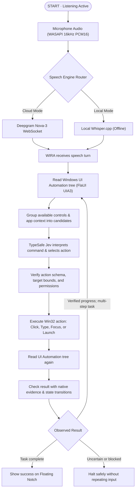

# WIRA (Windows Intelligent Runtime Assistant)

> A Windows voice assistant that understands commands and executes them safely using TypeSafe's Jev.

WIRA reads the controls that Windows applications provide through **Windows UI Automation (UIA)**. These controls form an **Accessibility tree**: a structured hierarchy of windows, buttons, text inputs, menus, and interactive elements.

Instead of guessing pixels with slow and brittle computer vision models, WIRA inspects native OS controls directly. 

Speech is converted to text via **Cloud (Deepgram Nova-3)** or **Local (Whisper.cpp)**. TypeSafe's **Jev** model interprets natural language commands, selects deterministic next actions, and verifies the observed system state after each step.

---

## How it works

The main command and verification flow is shown below. TypeSafe Jev participates in intent interpretation, action selection, and state verification throughout the loop.



### 1. Capture speech (Cloud or Local)
When listening is active, WIRA captures audio from the default Windows recording device at 16 kHz 16-bit mono PCM using WASAPI (`NAudio`).
- **Cloud Mode (Deepgram Nova-3)**: Streams audio over WebSocket for ultra-low latency real-time transcription.
- **Local Mode (Whisper.cpp)**: Transcribes voice locally on your CPU/GPU for complete offline privacy.

You can toggle between Cloud and Local engines anytime directly from the floating top-bar menu.

### 2. Inspect the Windows Accessibility tree
WIRA queries the active foreground window through Windows UI Automation (`FlaUI.UIA3`). It extracts:
- App identity (Win32, UWP / Windows Store apps, PWAs)
- Interactive controls (buttons, edit boxes, tabs, combo boxes, menus)
- Bounding rectangles, automation IDs, keyboard shortcuts, and control patterns

Because WIRA reads the structured accessibility tree instead of capturing screenshots, it operates with zero pixel guesswork, minimal latency, and full support for dynamic UI layouts.

### 3. Let TypeSafe Jev choose the next action
Candidate controls and command context are structured and passed to TypeSafe's `typesafe/jev-1.13` model. Jev:
- Determines the user's intent and target application.
- Selects the exact target element, navigation URL, application launch target, or keystroke sequence.
- Rejects commands or signals when no matching action exists.

Prompt instructions and choice evaluation are strictly separated from input execution code.

### 4. Execute and verify safely
WIRA executes the chosen action using native Win32 input simulation. Immediately following execution, WIRA inspects the UI tree again:
- Confirms whether a window opened, a button changed state, or focus moved.
- Matches native evidence against Jev's expected outcome.
- Halts execution immediately if the result is ambiguous or unexpected, preventing errant clicks or runaway loops.

---

## Floating Notch UI

WIRA features a minimalist floating overlay pinned to the top of your primary display:

- **Mic Toggle**: Click to start/stop listening or monitor live audio levels.
- **Audio Equalizer**: Real-time waveform reactive to your microphone.
- **Options Menu (3 dots)**:
  - `Cloud (Deepgram)`: Switch to Deepgram Nova-3 streaming.
  - `Local (Whisper)`: Switch to offline Whisper.cpp.
  - `Exit`: Gracefully shut down the assistant.

---

## API Keys & Configuration

Create a `.env` file in the project root (see [`.env.example`](.env.example)):

```bash
# ==============================================================================
# 1. Decision Model (TypeSafe Jev) - REQUIRED
# ==============================================================================
JEV_PROVIDER=openrouter

# Recommended: OpenRouter (Model: typesafe/jev-1.13)
# Get your key at: https://openrouter.ai/keys
OPENROUTER_API_KEY=your_openrouter_api_key_here

# Alternative: Direct TypeSafe API endpoint
# Get your key at: https://typesafe.ai
TYPESAFE_API_KEY=your_typesafe_api_key_here

# ==============================================================================
# 2. Speech-to-Text (Deepgram) - OPTIONAL
# ==============================================================================
# Required only if using Cloud Deepgram Nova-3 mode.
# Not required for Local Whisper mode.
# Get your key at: https://console.deepgram.com
DEEPGRAM_API_KEY=your_deepgram_api_key_here

# ==============================================================================
# 3. Local Whisper Model - OPTIONAL
# ==============================================================================
# Path to local whisper model file (defaults to models/ggml-base.bin)
WHISPER_MODEL_PATH=models/ggml-base.bin
```

| Key | Required? | Purpose |
| --- | --- | --- |
| `OPENROUTER_API_KEY` or `TYPESAFE_API_KEY` | **Yes** | Powers the TypeSafe Jev decision layer (`typesafe/jev-1.13`) for interpreting commands and planning actions. |
| `DEEPGRAM_API_KEY` | Optional | Used for Cloud real-time streaming speech-to-text (Nova-3). Not required if using Local Whisper mode. |
| `WHISPER_MODEL_PATH` | Optional | Points to a local GGML model file (`.bin`) for offline transcription. |

---

## Setup

### Requirements
- **Windows 10 or 11** (x64 or ARM64)
- **[.NET 8.0 SDK](https://dotnet.microsoft.com/download/dotnet/8.0)** or higher

### 1. Clone the repository
```bash
git clone https://github.com/Mounieshh/wira-voice.git
cd wira-voice
```

### 2. Configure environment
Copy the template and fill in your keys:
```powershell
Copy-Item .env.example .env
```
Add your `OPENROUTER_API_KEY` (or `TYPESAFE_API_KEY`), and optionally `DEEPGRAM_API_KEY`.

### 3. Run the application
```powershell
dotnet run
```

---

## Usage Examples

Once running, speak naturally into your microphone:

- **Launch apps & navigation**:
  - *"Open Notepad"*
  - *"Open Chrome and go to github.com"*
  - *"Launch Settings"*
- **Desktop & UI interaction**:
  - *"Click New File"*
  - *"Type Hello World into the text area"*
  - *"Save the file"*
- **System controls**:
  - *"Mute the audio"*
  - *"Maximize this window"*

---

## Repository Structure

```text
wira-voice/
├── Core/
│   ├── Audio/          # WASAPI 16kHz audio capture & microphone metering (NAudio)
│   ├── Automation/     # Windows UI Automation (FlaUI.UIA3) tree inspection & Win32 input
│   ├── Commands/       # Turn coordination, command pipeline, preemption & checkpoints
│   ├── Config/         # Environment variables & runtime settings (.env)
│   ├── Decision/       # TypeSafe Jev client, prompt formatters & outcome verification
│   ├── Language/       # Jev choice grouping, cost tracking & action schemas
│   └── Speech/         # Dual STT engines: Deepgram Nova-3 & Local Whisper.cpp
├── UI/
│   ├── FloatingTopBar.xaml     # Minimalist top floating notch overlay
│   └── FloatingTopBar.xaml.cs  # Waveform rendering, mic toggle & mode selector
├── tests/
│   └── WiraVoice.Tests/        # Unit & integration test suite (xUnit, 58+ tests)
├── .env.example        # Environment variable template
├── App.xaml            # WPF application entry point
└── WiraVoice.csproj    # .NET 8 WPF project file
```

---

## Testing

Run the full test suite without a physical microphone:

```powershell
dotnet test
```

All 58+ tests cover UI Automation tree grouping, Jev tokenization and prompt validation, speech engine switching, and command coordination.

---

## Safety & Boundaries

WIRA is an experimental assistant with strict safety guardrails:
- **No pixel hallucinations**: Operates exclusively against verified accessibility nodes.
- **Preemption**: Starting to speak immediately pauses previous unconfirmed actions.
- **Verification loops**: If an action does not produce expected UI changes, WIRA stops rather than retrying blindly.
- **Always controllable**: The floating notch can be toggled or closed instantly via mouse or `Ctrl+C` in the terminal.
