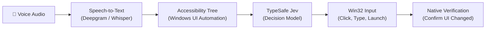

# WIRA (Windows Intelligent Runtime Assistant)

> A Windows voice assistant that understands commands and executes them safely using TypeSafe's Jev.

WIRA lets you control your Windows PC with your voice.

Instead of guessing pixels with slow computer vision models, WIRA reads the native controls that apps provide through **Windows UI Automation (UIA)**. These controls form an **Accessibility tree** — a hierarchy of windows, buttons, text inputs, and menus.

Speech is converted to text via **Cloud (Deepgram Nova-3)** or **Local (Whisper.cpp)**. TypeSafe's **Jev** model interprets your command, chooses the next action, and verifies the result.

---

## How it works



1. **Hear**: Captures microphone audio using either **Cloud (Deepgram Nova-3)** for real-time streaming or **Local (Whisper.cpp)** for offline privacy.
2. **Read**: Inspects the active foreground window directly through Windows UI Automation (`FlaUI.UIA3`) to map available buttons, text boxes, and menus without taking screenshots.
3. **Decide**: TypeSafe's Jev model (`typesafe/jev-1.13`) evaluates your command against the available controls and selects a structured action (or reports no match).
4. **Execute & Verify**: WIRA executes the action (click, type, open app/URL) and re-checks the accessibility tree to confirm the expected change actually happened before proceeding.

---

## Floating Notch UI

WIRA runs as a lightweight floating bar at the top of your screen:

- **Mic Toggle**: Click to start or pause listening.
- **Equalizer**: Live audio waveform reacting to your voice.
- **3-Dot Menu**:
  - `Cloud (Deepgram)`: Fast cloud streaming via Deepgram Nova-3.
  - `Local (Whisper)`: Private, on-device transcription via Whisper.
  - `Exit`: Gracefully shut down the assistant.

---

## API Keys

Copy the template to create your `.env` file:

```powershell
Copy-Item .env.example .env
```

| Key | Description | Required? |
| --- | --- | :---: |
| `OPENROUTER_API_KEY` *(or `TYPESAFE_API_KEY`)* | Powers the **TypeSafe Jev** decision model (`typesafe/jev-1.13`) to interpret commands and plan actions. | **Yes** |
| `DEEPGRAM_API_KEY` | Streaming cloud speech recognition (**Deepgram Nova-3**). | Optional *(Cloud mode only)* |
| `WHISPER_MODEL_PATH` | Path to local model (defaults to `models/ggml-base.bin`). | Optional *(Local mode only)* |

---

## Setup & Quickstart

### Prerequisites
- **Windows 10 or 11**
- **[.NET 8.0 SDK](https://dotnet.microsoft.com/download/dotnet/8.0)** or higher

### 1. Clone the repository
```bash
git clone https://github.com/Mounieshh/wira-voice.git
cd wira-voice
```

### 2. Configure environment
```powershell
Copy-Item .env.example .env
```
Open `.env` and add your `OPENROUTER_API_KEY` (and `DEEPGRAM_API_KEY` if using cloud mode).

### 3. Run
```powershell
dotnet run
```

---

## Example Commands

- **Open apps & web pages**:
  - *"Open Notepad"*
  - *"Open Chrome and go to github.com"*
  - *"Launch Settings"*
- **Interact with the screen**:
  - *"Click New Tab"*
  - *"Type Hello World into the search box"*
  - *"Save the document"*
- **System controls**:
  - *"Mute the audio"*
  - *"Maximize this window"*

---

## Testing

Run the automated test suite without needing a microphone:

```powershell
dotnet test
```

All 58 tests verify UI tree grouping, Jev tokenization, prompt generation, speech engine switching, and command execution.

---

## Safety Guardrails

- **No Pixel Hallucinations**: Interacts only with verified accessibility elements.
- **Voice Preemption**: Speaking pauses unconfirmed actions immediately.
- **Outcome Verification**: If an action does not produce the expected state change, WIRA stops safely rather than repeating actions.
- **Instant Control**: Easily toggle listening or exit from the floating notch at any time.
